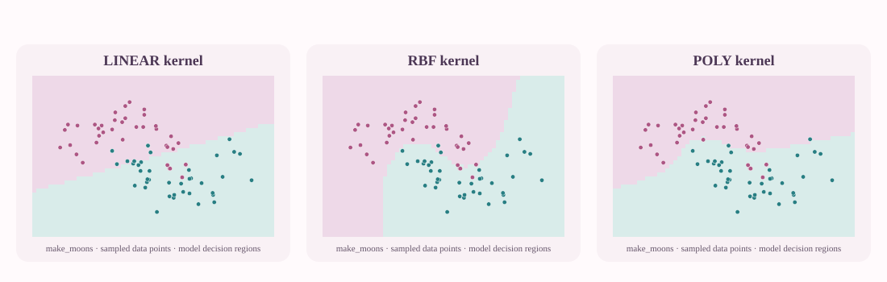
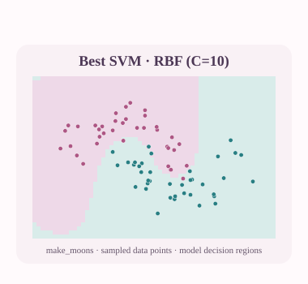

# SVM Kernel Comparison & Hyperparameter Optimization

An educational machine learning experiment comparing **linear**, **RBF**, and **polynomial** support vector classifiers on a nonlinearly separable, synthetic dataset.

## Overview
The script demonstrates:
- Generating the `make_moons` dataset with 300 samples and Gaussian noise.
- Splitting into 80% training and 20% testing samples.
- Comparing SVM kernels using **accuracy, recall, and F1 score**.
- Visualizing class decision regions for different kernels.
- Using **GridSearchCV** (5-fold, F1 scoring) to search kernel, `C`, and `gamma` settings.
- Evaluating and plotting the best model on the held-out set.

## Visual results

### Decision boundaries by kernel


### Best model selected with GridSearchCV


The plots are generated from the same seeded `make_moons` data and model settings as the original exercise. They illustrate how different kernels fit nonlinear class boundaries.

## Run locally
```bash
python -m venv .venv
# Activate the environment, then:
pip install -r requirements.txt
python svm_kernel_comparison.py
```

## Interpretation and limitations
The visualized boundaries illustrate model flexibility and kernel behavior. This is a **course exercise**, not a claim about performance on a real industrial dataset. The original script displays plots interactively; the image assets in this README were regenerated for documentation.

## Skills demonstrated
`Python` · `Scikit-learn` · `Support Vector Machines` · `Grid Search` · `Cross-validation` · `Decision Boundaries`
